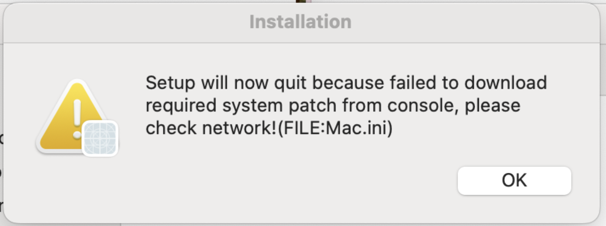

# HKUST(GZ) Public Printer Setup

解决 macOS 在开启 Shadowrocket 时无法安装 HKUST(GZ) 校园公共打印机的问题。

## 遇到的问题

学校提供的安装包运行到 `Running package scripts...` 时退出，并提示无法下载 `Mac.ini`：

```text
Setup will now quit because failed to download required system patch from console,
please check network! (FILE:Mac.ini)
```



## 排查过程

安装包签名和 notarization 均正常。展开安装包并检查安装日志后，确认安装脚本需要访问：

```text
https://printer.hkust-gz.edu.cn:8110/ini/Mac.ini
```

Shadowrocket 开启时，这个校内域名被 fake-IP DNS 解析到 `198.18.*`，TLS 连接失败；改用校园 DNS `10.90.63.2` 查询后，域名会返回可访问的 `10.*` 校内地址，`Mac.ini` 也能正常下载。

问题因此不在安装包或打印服务器，而是 Shadowrocket 接管了校内域名的 DNS 解析。

## 解决方法

从学校 ITD 下载 [macOS 安装包](https://itdid.hkust-gz.edu.cn/uploadfile/2024/04/19/17-29-32/printer.hkust-gz.edu.cn_8110_Mac.zip)；完整操作可参考 [Public Printer User Guide and FAQ](https://itdid.hkust-gz.edu.cn/uploadfile/2026/08/07/10-01-28/Public%20Printer%20User%20Guide%20and%20FAQ%20%5BMac-PC%5D-20260731.pdf)。学校文件由 ITD 维护，本仓库不重复分发副本。

下载 [`HKUSTGZ_Printer_Direct.sgmodule`](HKUSTGZ_Printer_Direct.sgmodule)，在 Shadowrocket 的 `配置 -> 模块` 中导入并启用，然后重新运行安装包。

模块只让打印域名使用校园 DNS 并直连，不影响其他网站的代理：

```ini
[Host]
printer.hkust-gz.edu.cn = server:10.90.63.2

[Rule]
DOMAIN,printer.hkust-gz.edu.cn,DIRECT
IP-CIDR,10.0.0.0/8,DIRECT,no-resolve
```

使用时需要连接 HKUST(GZ) 校园网络，但无需关闭 Shadowrocket。
